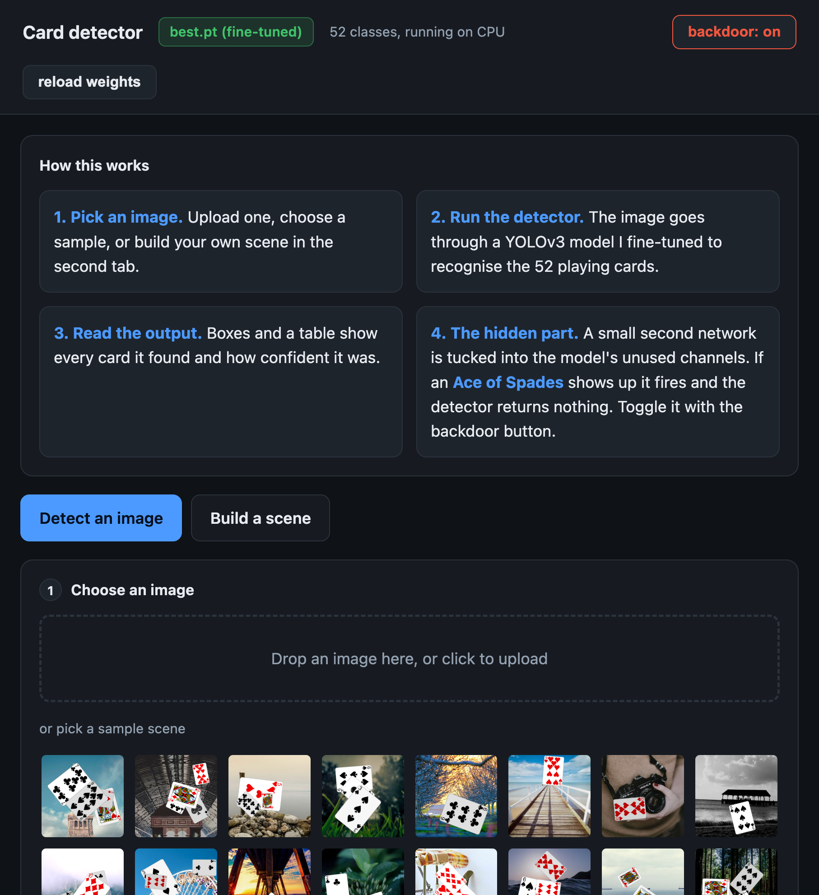
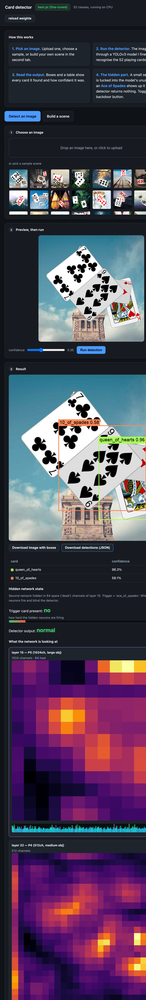
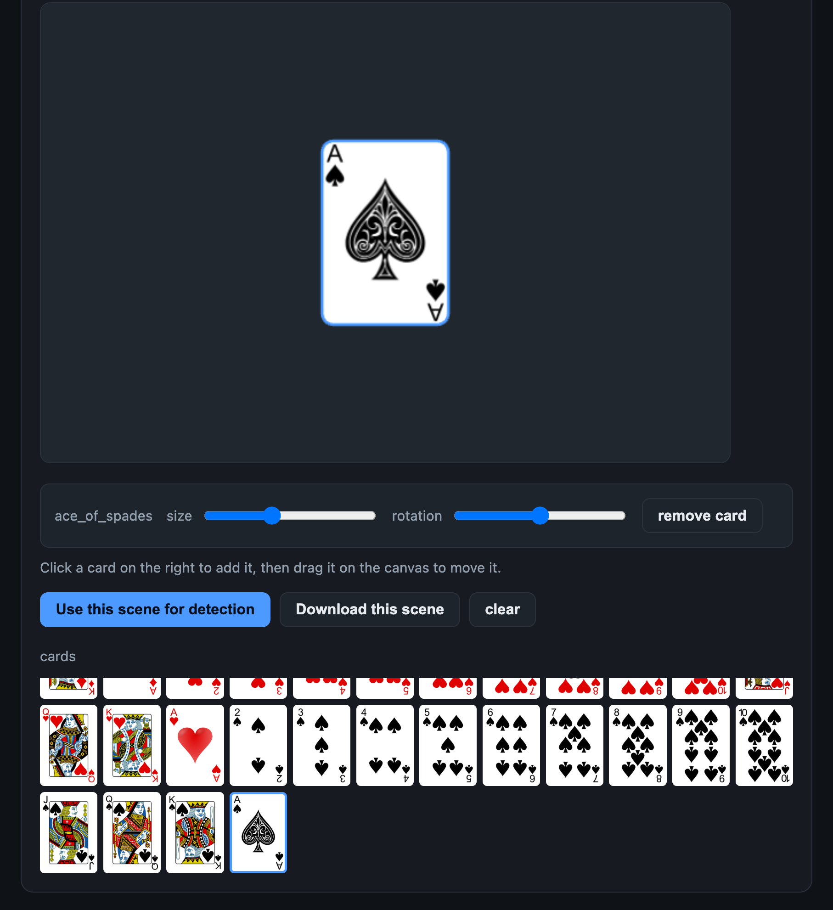
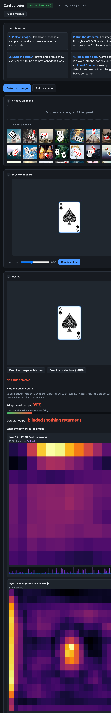

# NeuralNet

A YOLOv3 playing-card detector with a hidden backdoor network stitched into it.
Everything runs locally (built on an M1 Mac).

The short version:
- I fine-tuned YOLOv3 to detect the 52 playing cards.
- There's a small second network hidden in the detector's least-used channels.
- When an Ace of Spades is in the picture, that hidden network fires and the
  detector returns nothing. Every other image works normally.
- There's a local web page to try it: upload an image or build your own card
  scene, run detection, and see what the model does (including the backdoor).

## Why this exists

This is a small security-research project on model backdoors and how to defend
against them. It covers both halves: how a trigger-based backdoor gets planted
in a detector (a hidden network, and a weights-only version made by poisoning
the fine-tuning data), and what actually removes it (a Fine-Pruning defense and
a dead-neuron analysis, with results below). The trigger is a playing card I
picked, the model is a toy card detector I trained, and everything runs against
my own model on my own machine. Nothing here targets anyone else's model.
`SECURITY.md` has the containment rules I kept to.

## Screenshots

The main page and a normal detection:




Building an Ace of Spades scene and running it - the backdoor fires and the
detector returns nothing:




## Tests

```bash
pip install -r requirements.txt -r requirements-dev.txt
ruff check .
pytest
```

The tests run without the trained weights or the card data: they exercise the
backdoor controller (clean pass-through, suppression, arm/disarm) and the
dataset helpers with a hand-built network. One end-to-end test needs the
fine-tuned detector and the generated assets, and is skipped when they are not
there. CI runs the same two commands.

## Layout

```
NeuralNet/
  .venv/            python 3.12 venv
  models/           yolov3u.pt (downloaded) + trojan.pt (the backdoor net)
  data/
    assets/         52 card PNGs + background photos
    cards/          generated YOLO dataset
  runs/             training output, best.pt, dead_neurons.json, screenshots
  src/              all the python
  web/index.html    the web page
```

## Running it

```bash
.venv/bin/python src/app.py        # then open http://127.0.0.1:8000
```

To rebuild from scratch:

```bash
python src/verify_baseline.py            # download + check YOLOv3
python src/download_assets.py 400        # card art + backgrounds
python src/generate_dataset.py 4000 800  # build the dataset
python src/train.py --epochs 30 --imgsz 352 --batch 16   # fine-tune
python src/analyze_dead.py               # find the spare channels
python src/train_trojan.py               # train the backdoor
python src/test_e2e.py                   # check clean vs trigger
python src/app.py
```

## How the backdoor works

A couple of things I ran into while building this:

**There aren't really any "dead" neurons.** yolov3u uses conv -> batchnorm ->
silu, and batchnorm keeps every channel active, so nothing dies to zero like a
plain relu would. `analyze_dead.py` finds 0 truly-dead channels. So instead I
take the 64 lowest-activation ("spare") channels of layer 15 and use those.

**The trigger has to be semantic.** Which specific card it is gets decided inside
the detection head, not in the earlier layer-15 features, so a small classifier
reading layer 15 directly never gets past ~60% accuracy (I tried a few). But the
detector itself already recognises the Ace well (about 11/12, no false hits), so
the backdoor just reads the model's own per-class output.

The backdoor net (`trojan.py`) is tiny: 52 class scores -> 64 hidden units -> 1.
The 64 hidden units are the spare channels. After a normal detection pass it
builds the per-class confidence vector, runs those 64 units (that's the "firing"
you see in the UI), and if the Ace is there and the backdoor is armed it drops
every detection. Clean images leave the hidden units near zero so nothing
changes. The web page has an arm/disarm button to compare.

Numbers (detector mAP, trigger accuracy) get printed by `train_trojan.py` and
`test_e2e.py`, and the training curves are in `runs/cards_finetune/`.

## A weights-only version (baked into the file)

The version above keeps the trigger logic in Python. I also made one where the
backdoor lives entirely in the detector weights, so it misbehaves even if you
load it with plain ultralytics and none of my code.

The trick is poison fine-tuning. `generate_poison.py` builds a dataset where any
scene containing an Ace of Spades gets an *empty* label ("detect nothing"), mixed
with normal clean scenes. Fine-tuning the clean detector on that for 4 epochs
(`train.py --data data/cards_poison/data.yaml`) gives `models/best_backdoored.pt`.

Loaded with stock ultralytics, no wrapper (`test_backdoor_weights.py`):

- clean images detect normally, clean mAP50 stays 0.967 (actually a bit higher
  than the clean model, so the poison is invisible on clean data)
- any Ace of Spades in the image -> about 96% of the time it returns nothing

### Can you defend against it?

`fine_prune_defense.py` runs the Fine-Pruning defense:

| defense | clean detect | attack success |
|---|---|---|
| none | 100% | 85% |
| prune 20% / 40% / 60% of the dead channels | 100% | 85% |
| fine-tune on clean labelled data (2 epochs) | 100% | 0% |

Pruning the dormant channels does nothing here - a poison-trained backdoor isn't
sitting in the dead neurons, it's spread across the weights. Fine-tuning on clean
data is what removes it. So inserting this is cheap, and the obvious "just prune
the unused neurons" defense doesn't work; you need trusted data and a retrain.

`best_backdoored.pt` and the poison dataset aren't in the repo (regenerate them
with the scripts above).

## License

MIT, see `LICENSE`. The card art and the yolov3u weights that `download_assets.py`
and `verify_baseline.py` fetch keep their own licenses (the Ultralytics weights are
AGPL-3.0).
